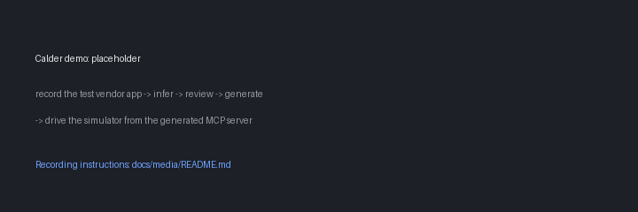
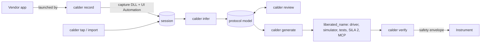

# Calder

**Watch a lab instrument's vendor software talk to the instrument, infer the protocol, and get a
tested open driver plus SiLA 2 and MCP servers.**

[](https://github.com/ide-bloom/calder/actions/workflows/ci.yml)
[](https://github.com/ide-bloom/calder/releases)
[](https://pypi.org/project/calder/)
[](LICENSE)



*The demo GIF is a placeholder until it is recorded; [docs/media/README.md](docs/media/README.md)
describes how.*

Alexander Calder, trained as an engineer, set rigid machinery free as moving mobiles. Calder frees
lab instruments from the software that locked them in.

## Why Calder exists

Self-driving labs need software control of instruments: balances, pumps, thermostats,
spectrometers, potentiostats, plate readers, power supplies. Many can only be driven by
Windows-only vendor software that speaks an undocumented protocol, and integrating one usually
means reverse-engineering it by hand. Existing aids help only part of the way:

- Patented LIMS tooling records instrument transmissions to help an engineer write a connectivity
  driver by hand.
- Graphical driver builders turn hand-drawn parsing diagrams into code.
- NI's instrument driver wizard generates project templates.
- Research such as LABIIUM uses a large language model to write automation code for documented
  instruments.

None of them synthesizes and verifies a driver by watching the vendor software. Calder records
every byte on the wire alongside every UI action, infers framing, checksums, message types, field
encodings and the command state machine, correlates wire fields with the values the user typed,
and generates a typed Python driver, a SiLA 2 server, an MCP server, a replay simulator and tests.
It then verifies the driver against the instrument inside a strict safety envelope.

Inference results are hypotheses backed by evidence: every inferred fact links to the recorded
events that support it, lists the alternatives considered, and is marked uncertain when it is.

## How it works



1. **Record.** `calder record` launches the vendor application with a Microsoft Detours capture DLL
   of the matching bitness and records serial, VISA, FTDI, WinUSB, HID and TCP traffic, plus UI
   Automation events (clicks, typed values, selections) on the same clock.
2. **Infer.** Framing, checksums, message types, field encodings, enumerations, counters, status
   codes, request/response pairs, UI correlations, a k-tails state machine and preconditions.
   See [docs/inference.md](docs/inference.md).
3. **Review.** A local web UI shows the timeline, messages, fields, framing, checksum and state
   machine; rename, retype, accept or reject anything, with an audit trail.
4. **Generate.** A `liberated_<name>` package that passes its own tests, `ruff` and `mypy --strict`.
5. **Verify.** Read-only, replay and explore phases against the real instrument, with rate limits,
   confirmations and immediate abort.

## Install

```
pip install calder                 # or: uv tool install calder
pip install "calder[manual]"       # optional: PDF manual assist
```

Recording vendor applications needs Windows. The Windows wheel bundles the 32- and 64-bit capture
DLLs and launchers; UI recording needs the .NET 10 Desktop Runtime. Inference, generation, the
review UI and verification run anywhere Python 3.12+ runs. `calder doctor` checks your setup.

From source:

```
git clone https://github.com/ide-bloom/calder && cd calder
uv sync --all-extras --dev
python scripts/build_native.py     # Windows: DLLs, launchers, UI helper, test vendor app
```

## Quick start

```
calder record --app "C:\Program Files\Vendor\Vendor.exe" --ui --filter "serial:COM5" --out sessions\run1.libsession
calder infer sessions\run1.libsession sessions\run2.libsession --out model.json --name thermostat
calder review model.json
calder generate model.json --out liberated_thermostat
cd liberated_thermostat && pytest
calder verify liberated_thermostat --resource COM5 --phase read
```

```python
from liberated_thermostat import ThermostatDriver

with ThermostatDriver.connect("COM5") as t:
    t.syst_rem()
    t.sour_temp(setpoint=37.5)       # °C; documented with the evidence it was inferred from
    print(t.meas_temp_query())
```

Try it without hardware: the test suite's simulators speak realistic protocols, and
`calder simulate model.json` turns any model into a virtual instrument on TCP.

## CLI reference

| Command | What it does |
|---|---|
| `calder record --app EXE [--args ARGS] [--transport auto\|serial,visa,ftdi,winusb,hid,tcp] [--filter SPEC] [--ui] [--out FILE] [--duration S] [--drive SCRIPT]` | Launch the vendor app with the capture DLL; record wire events and, with `--ui`, UI Automation events. `--drive` replays a UI script for reproducible demos and tests. |
| `calder tap --a COM5 --b COM6 --baud 9600 [--bytesize --parity --stopbits --duration --out]` | Record from a passive serial tap (two receive-only adapters on a Y-cable). |
| `calder import CAPTURE.pcapng [--out FILE]` | Convert USBPcap or Ethernet captures (pcapng or pcap) into a session. |
| `calder infer SESSION... [--out model.json] [--name N] [--stream S] [--manual PDF] [--k 2] [--naming-endpoint URL --naming-model M]` | Build a protocol model. |
| `calder review MODEL [--port P] [--no-browser]` | Open the review UI on 127.0.0.1 with a per-launch token. |
| `calder generate MODEL --out DIR [--name N] [--sila/--no-sila] [--mcp/--no-mcp] [--force]` | Generate the driver package and servers. |
| `calder verify DRIVER_DIR --resource PORT\|VISA\|HOST:PORT [--phase read\|replay\|explore] [--allow-actuation] [--limits FILE] [--rate HZ] [--log FILE]` | Verify against the live instrument ([docs/safety.md](docs/safety.md)). |
| `calder simulate MODEL\|DRIVER_DIR [--host H] [--port P]` | Run the replay simulator as a virtual instrument on TCP. |
| `calder doctor` | Check Python, native binaries, the VISA runtime, the .NET runtime and permissions. |

Filter patterns are `transport:identity` with `*` and `?` wildcards, for example
`serial:COM5`, `serial:\\.\pipe\*`, `tcp:192.168.1.10:5025`, `visa:USB0::*`, `hid:*vid_1d50*`.

## Supported transports and protocols

**Captured transports:** Win32 serial ports and named pipes; VISA (`visa32`/`visa64`: USB-TMC,
GPIB, LAN and serial resources, raw and formatted I/O); FTDI D2XX; WinUSB; HID feature, output,
input and interrupt reports; TCP sockets; USBPcap/Wireshark captures; a passive serial tap.
32-bit and 64-bit vendor applications. Details and limits: [docs/hooks.md](docs/hooks.md).

**Inferred protocols:** delimited ASCII including SCPI and IEEE 488.2 common commands; fixed-width
ASCII including streamed readings; binary framing with start bytes, length fields, addresses,
opcodes, counters and checksums (63 catalogued CRCs, a parametrized CRC space, sums, XOR/LRC,
Fletcher-16); message-oriented HID/USB reports; Modbus RTU, ASCII and TCP.

**Generated:** typed Python driver (pyserial, pyvisa, sockets, FTDI D2XX, pyusb or hidapi),
framing codec with checksum, typed messages, replay simulator, pytest suite, SiLA 2 feature
definition and server (`sila2`), MCP server (official MCP Python SDK). See
[docs/generation.md](docs/generation.md).

## The safety envelope

Instruments heat, move, dispense, pressurize and apply high voltage. `calder verify`:

- `read`: sends only byte-identical recorded queries and compares responses structurally;
- `replay`: requires `--allow-actuation` and an interactive confirmation per command class, and
  replays recorded commands with their recorded values only;
- `explore`: additionally requires a limits file you write, and varies parameters only within the
  observed and user-specified ranges;
- never sends an opcode or mnemonic that was not observed;
- always applies a rate limit, aborts immediately on an unexpected response, an error status or a
  timeout, logs every byte, and warns that the operator must be at the instrument with its own
  emergency stop.

Generated MCP servers refuse actuating commands without `confirm=true`, and generated drivers
enforce inferred preconditions. See [docs/safety.md](docs/safety.md).

## Legal note

Use Calder only with instruments and software you own or are licensed to use, for
interoperability. Recording traffic to build an interoperable driver is permitted in many
jurisdictions, but license terms and laws differ; check yours. Do not use Calder to circumvent
access controls or to redistribute vendor software or proprietary protocol documentation.

## Limitations

- Inference sees only what was recorded: unexercised commands, error paths and parameter ranges
  stay unknown. Record several sessions that use every feature you need.
- Preconditions and classifications are hypotheses; confirm them in the review UI.
- A value's scale is recovered only when the UI showed or accepted the value.
- VISA formatted reads (`viScanf`, the read half of `viQueryf`) are visible as events but their
  bytes are not; ConnectEx sockets and child processes are not captured.
- Compound SCPI lines (`A;B`) are typed as a whole; variable-length binary fields are split into
  per-length message types.
- Vendor software with its own kernel driver needs USBPcap or a serial tap.
- Generated drivers are synchronous.

## FAQ

**Does Calder modify the vendor software?** No. It injects a recording DLL into the process it
launches; the binary on disk is unchanged, and the DLL only observes calls.

**Does it need the instrument's manual?** No. A PDF manual can add names and descriptions.

**Does it need a language model?** No. Naming suggestions from an OpenAI-compatible endpoint are
opt-in and marked as suggestions; everything else is deterministic and offline.

**Can I use it on Linux or macOS?** Inference, review, generation, simulation and verification,
yes. Recording vendor applications needs Windows; pcapng imports work anywhere.

**What if inference is wrong?** Every element shows its evidence and alternatives; fix it in the
review UI (rename, retype, reject) and regenerate.

## Roadmap

- Variable-length binary fields and nested structures
- Observable SiLA 2 commands for long-running operations
- Async drivers
- Kernel-mode capture through USBPcap live recording
- More protocol families (CANopen, proprietary checksum families)

## Contributing

Architecture: [docs/architecture.md](docs/architecture.md). Formats:
[docs/session-format.md](docs/session-format.md), [docs/protocol-model.md](docs/protocol-model.md).

## Security

Report vulnerabilities privately; see [SECURITY.md](SECURITY.md).

## License

Apache License 2.0; see [LICENSE](LICENSE) and [THIRD_PARTY_NOTICES.md](THIRD_PARTY_NOTICES.md).
