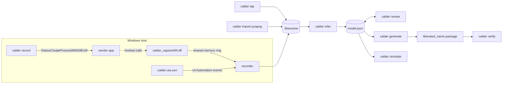

# Architecture

## Packages

| Path | Role |
|---|---|
| `src/calder/capture/` | `launcher.py` (PE bitness, native launcher), `ring.py` (shared-memory ring reader/writer), `recorder.py` (ring records to session events), `uia.py` (UI helper process), `tap.py` (passive serial tap), `pcapng.py` (capture import), `filters.py` (filter specs) |
| `src/calder/session/` | Session model and the `.libsession` container ([session-format.md](session-format.md)) |
| `src/calder/infer/` | Inference ([inference.md](inference.md)): `streams`, `framing`, `checksum`, `tokenize`, `align`, `fields`, `correlate`, `pairing`, `statemachine`, `modbus`, `classify`, `manual`, `naming`, `pipeline` |
| `src/calder/model/` | Protocol model schema, validation and projection to the runtime format ([protocol-model.md](protocol-model.md)) |
| `src/calder/runtime/` | Standard-library-only runtime shared by Calder and every generated driver: encodings, checksums, framers, codec, transports, client, replay simulator |
| `src/calder/generate/` | Package generator and Jinja templates ([generation.md](generation.md)) |
| `src/calder/verify/` | Live verification and the safety envelope ([safety.md](safety.md)) |
| `src/calder/web/` | Review UI (FastAPI plus embedded HTML, CSS and JavaScript) |
| `src/calder/cli.py` | Typer command-line interface |
| `native/capture/` | C++20 capture DLL, launcher, fake VISA/FTDI libraries and a hook test program ([hooks.md](hooks.md)) |
| `native/uirecorder/` | `calder-uia.exe` (C#, System.Windows.Automation) |
| `tests/simulators/` | Instrument simulators and programmatic session generators |
| `tests/vendorapp/` | WPF test vendor application |

## Design choices

- **One runtime, two users.** Inference validates its model by decoding every recorded frame with
  `calder.runtime` (the self-check in `infer/pipeline.py`). The generated driver embeds the same
  modules, so whatever passed the self-check is exactly what the driver sends and parses.
- **Evidence first.** Each inferred element carries an `Evidence` record (method, confidence,
  supporting events, alternatives). Nothing is stored without it.
- **A single clock.** The DLL and the UI helper both timestamp with QueryPerformanceCounter, so
  wire and UI events align without clock correction. UI Automation delivers events
  asynchronously; correlation tolerates UI events up to 0.5 s after the wire event they explain.
- **Injection only where asked.** The DLL is inert unless the recorder's ring exists, and it is
  only injected by the launcher into the process it starts.
- **Rejected elements disappear downstream.** The projection to the runtime format drops messages,
  preconditions and value fields the user rejected in review, so generated drivers and
  `verify` never see them.
